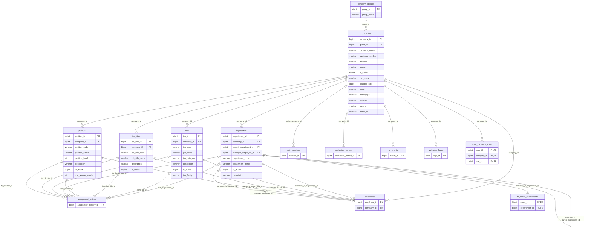
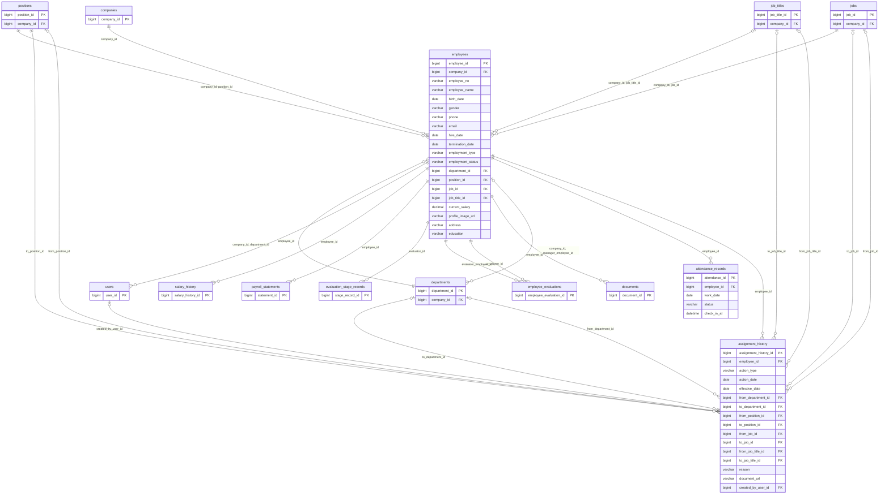
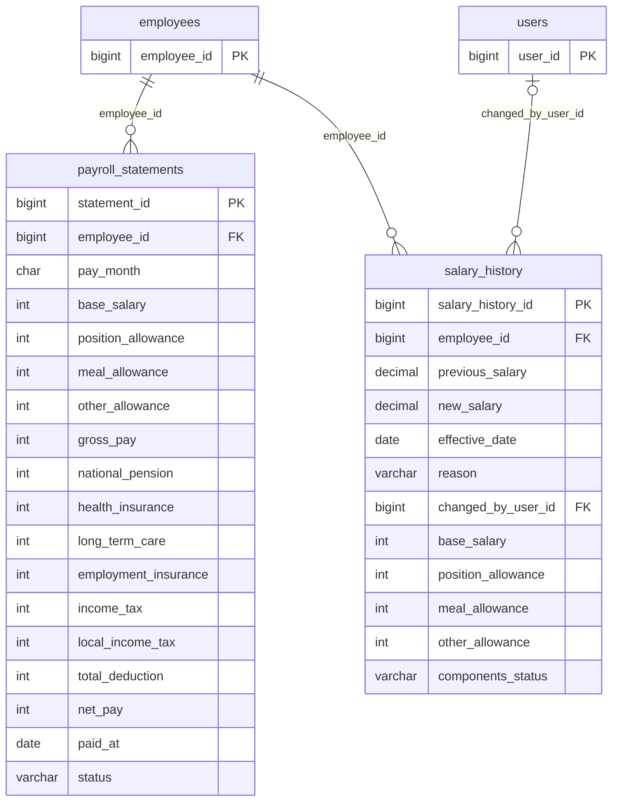
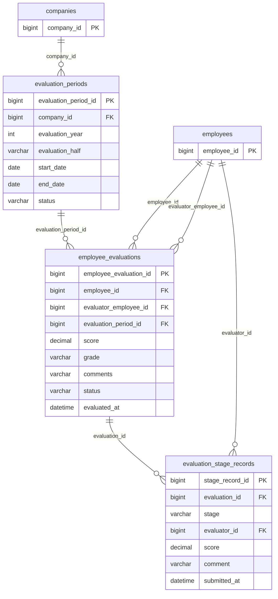
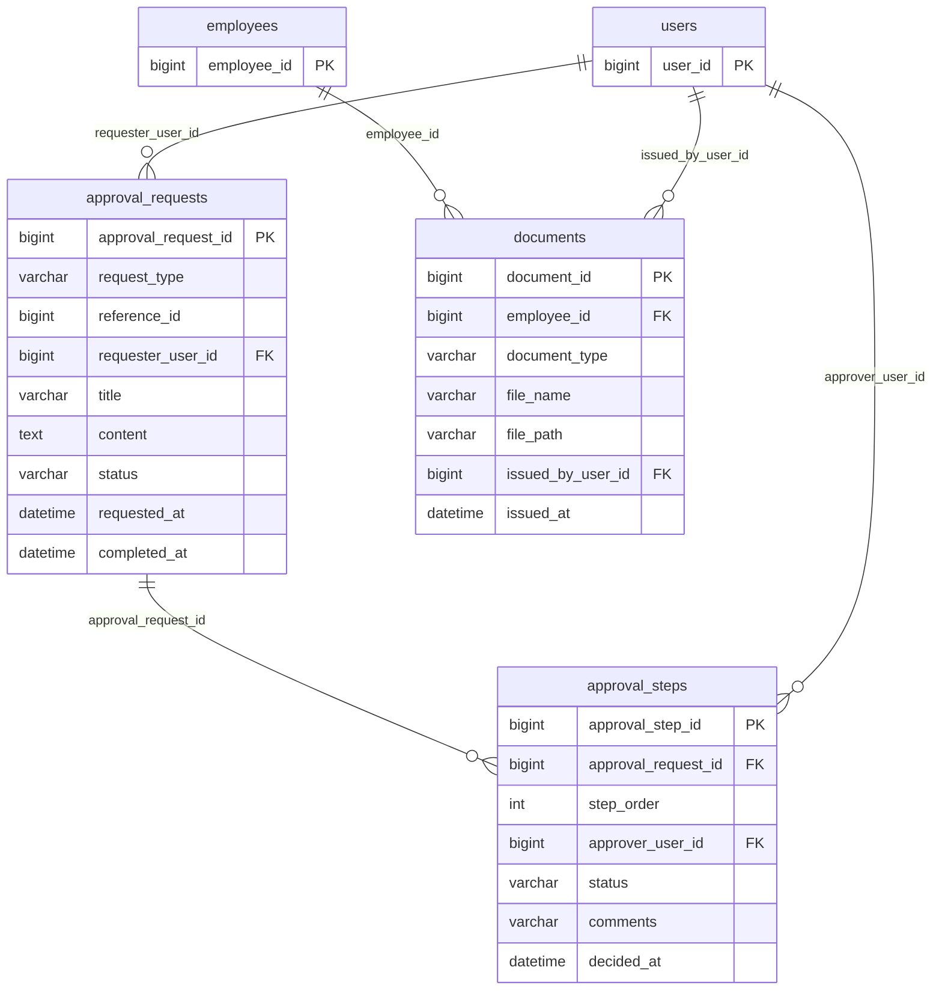
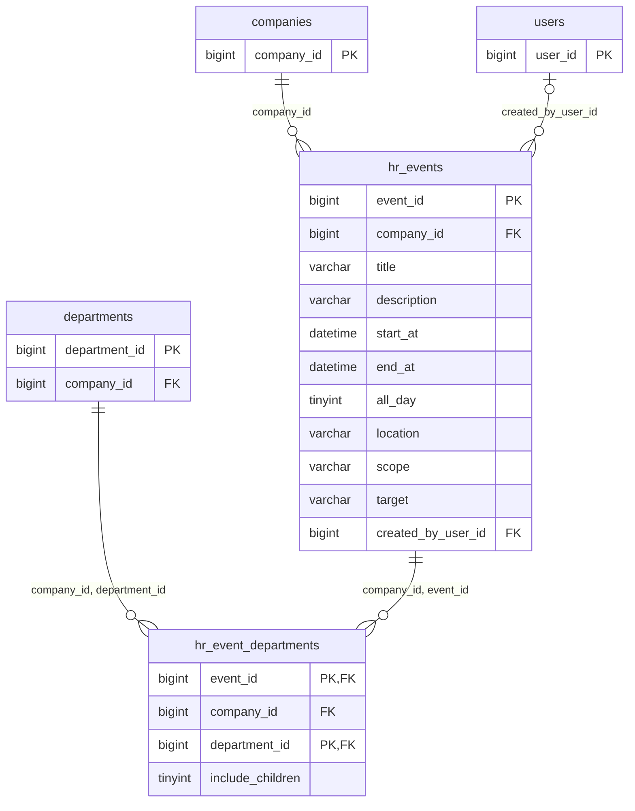
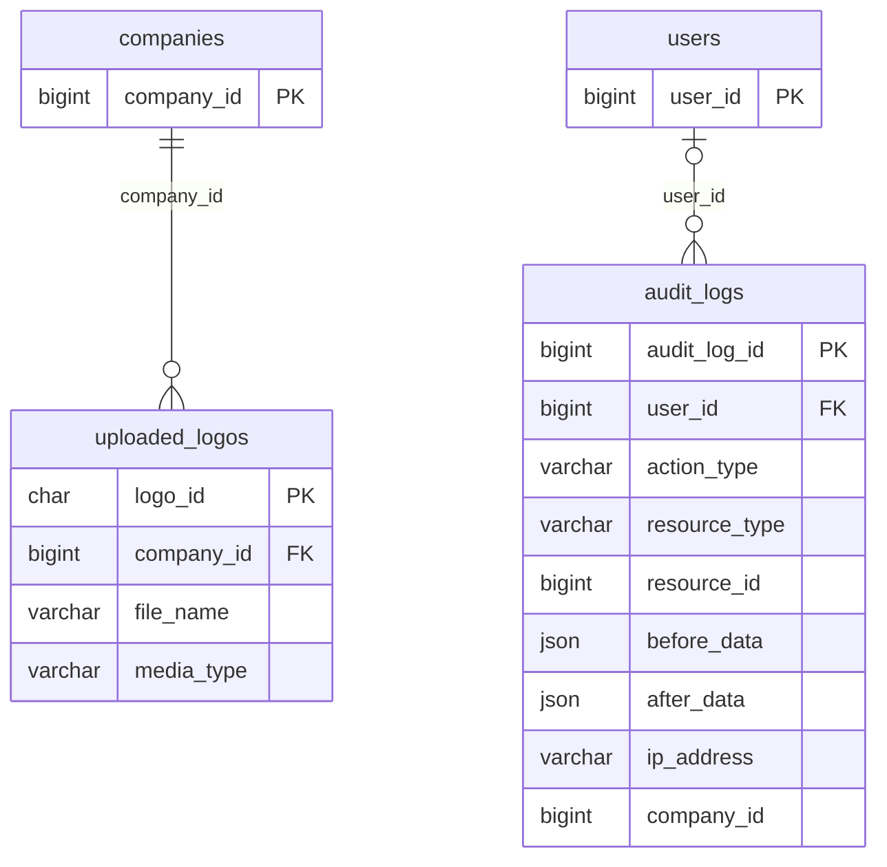

# HRIS ERD

MySQL 8.4 실제 스키마(마이그레이션 `024_password_change.sql`까지 적용)에서 생성 · 2026-11-24.

GitHub에서 그림으로 보입니다. 키 컬럼(PK, FK)만 표시하고, 전체 컬럼은 `data-dictionary.md`에 있습니다.
선 표기: `||` 반드시 1, `|o` 0 또는 1(FK가 NULL 가능), `o{` 0 이상.

```mermaid
erDiagram
    approval_requests {
        bigint approval_request_id PK
        bigint requester_user_id FK
    }
    approval_steps {
        bigint approval_step_id PK
        bigint approval_request_id FK
        bigint approver_user_id FK
    }
    assignment_history {
        bigint assignment_history_id PK
        bigint employee_id FK
        bigint from_department_id FK
        bigint to_department_id FK
        bigint from_position_id FK
        bigint to_position_id FK
        bigint from_job_id FK
        bigint to_job_id FK
        bigint from_job_title_id FK
        bigint to_job_title_id FK
        bigint created_by_user_id FK
    }
    attendance_records {
        bigint attendance_id PK
        bigint employee_id FK
    }
    audit_logs {
        bigint audit_log_id PK
        bigint user_id FK
    }
    auth_login_attempts {
        char attempt_key PK
    }
    auth_sessions {
        char session_id PK
        bigint user_id FK
        bigint active_company_id FK
    }
    companies {
        bigint company_id PK
        bigint group_id FK
    }
    company_groups {
        bigint group_id PK
    }
    departments {
        bigint department_id PK
        bigint company_id FK
        bigint parent_department_id FK
        bigint manager_employee_id FK
    }
    documents {
        bigint document_id PK
        bigint employee_id FK
        bigint issued_by_user_id FK
    }
    employee_evaluations {
        bigint employee_evaluation_id PK
        bigint employee_id FK
        bigint evaluator_employee_id FK
        bigint evaluation_period_id FK
    }
    employees {
        bigint employee_id PK
        bigint company_id FK
        bigint department_id FK
        bigint position_id FK
        bigint job_id FK
        bigint job_title_id FK
    }
    evaluation_periods {
        bigint evaluation_period_id PK
        bigint company_id FK
    }
    evaluation_stage_records {
        bigint stage_record_id PK
        bigint evaluation_id FK
        bigint evaluator_id FK
    }
    hr_event_departments {
        bigint event_id PK,FK
        bigint company_id FK
        bigint department_id PK,FK
    }
    hr_events {
        bigint event_id PK
        bigint company_id FK
        bigint created_by_user_id FK
    }
    job_titles {
        bigint job_title_id PK
        bigint company_id FK
    }
    jobs {
        bigint job_id PK
        bigint company_id FK
    }
    payroll_statements {
        bigint statement_id PK
        bigint employee_id FK
    }
    permissions {
        bigint permission_id PK
    }
    positions {
        bigint position_id PK
        bigint company_id FK
    }
    role_permissions {
        bigint role_id PK,FK
        bigint permission_id PK,FK
    }
    roles {
        bigint role_id PK
    }
    salary_history {
        bigint salary_history_id PK
        bigint employee_id FK
        bigint changed_by_user_id FK
    }
    uploaded_logos {
        char logo_id PK
        bigint company_id FK
    }
    user_company_roles {
        bigint user_id PK,FK
        bigint company_id PK,FK
        bigint role_id PK,FK
    }
    user_roles {
        bigint user_id PK,FK
        bigint role_id PK,FK
    }
    users {
        bigint user_id PK
        bigint employee_id FK
    }
    users ||--o{ approval_requests : "requester_user_id"
    approval_requests ||--o{ approval_steps : "approval_request_id"
    users ||--o{ approval_steps : "approver_user_id"
    users |o--o{ assignment_history : "created_by_user_id"
    employees ||--o{ assignment_history : "employee_id"
    departments |o--o{ assignment_history : "from_department_id"
    jobs |o--o{ assignment_history : "from_job_id"
    job_titles |o--o{ assignment_history : "from_job_title_id"
    positions |o--o{ assignment_history : "from_position_id"
    departments |o--o{ assignment_history : "to_department_id"
    jobs |o--o{ assignment_history : "to_job_id"
    job_titles |o--o{ assignment_history : "to_job_title_id"
    positions ||--o{ assignment_history : "to_position_id"
    employees ||--o{ attendance_records : "employee_id"
    users |o--o{ audit_logs : "user_id"
    companies |o--o{ auth_sessions : "active_company_id"
    users ||--o{ auth_sessions : "user_id"
    company_groups |o--o{ companies : "group_id"
    companies ||--o{ departments : "company_id"
    departments |o--o{ departments : "company_id, parent_department_id"
    employees |o--o{ departments : "company_id, manager_employee_id"
    employees ||--o{ documents : "employee_id"
    users ||--o{ documents : "issued_by_user_id"
    employees ||--o{ employee_evaluations : "employee_id"
    evaluation_periods ||--o{ employee_evaluations : "evaluation_period_id"
    employees ||--o{ employee_evaluations : "evaluator_employee_id"
    companies ||--o{ employees : "company_id"
    departments ||--o{ employees : "company_id, department_id"
    jobs ||--o{ employees : "company_id, job_id"
    job_titles |o--o{ employees : "company_id, job_title_id"
    positions ||--o{ employees : "company_id, position_id"
    companies ||--o{ evaluation_periods : "company_id"
    employee_evaluations ||--o{ evaluation_stage_records : "evaluation_id"
    employees ||--o{ evaluation_stage_records : "evaluator_id"
    departments ||--o{ hr_event_departments : "company_id, department_id"
    hr_events ||--o{ hr_event_departments : "company_id, event_id"
    companies ||--o{ hr_events : "company_id"
    users |o--o{ hr_events : "created_by_user_id"
    companies ||--o{ job_titles : "company_id"
    companies ||--o{ jobs : "company_id"
    employees ||--o{ payroll_statements : "employee_id"
    companies ||--o{ positions : "company_id"
    permissions ||--o{ role_permissions : "permission_id"
    roles ||--o{ role_permissions : "role_id"
    users |o--o{ salary_history : "changed_by_user_id"
    employees ||--o{ salary_history : "employee_id"
    companies ||--o{ uploaded_logos : "company_id"
    companies ||--o{ user_company_roles : "company_id"
    roles ||--o{ user_company_roles : "role_id"
    users ||--o{ user_company_roles : "user_id"
    roles ||--o{ user_roles : "role_id"
    users ||--o{ user_roles : "user_id"
    employees ||--o{ users : "employee_id"
```

## 도메인별

각 도메인의 테이블은 컬럼 전체(created_at, updated_at 제외), 직접 연결된 다른 도메인 테이블은 PK만 표시합니다.

### 조직

테이블: `company_groups`, `companies`, `departments`, `positions`, `job_titles`, `jobs` · 연결: assignment_history, auth_sessions, employees, evaluation_periods, hr_event_departments, hr_events, uploaded_logos, user_company_roles

### 인사

테이블: `employees`, `assignment_history`, `attendance_records` · 연결: companies, departments, documents, employee_evaluations, evaluation_stage_records, job_titles, jobs, payroll_statements, positions, salary_history, users

### 급여

테이블: `salary_history`, `payroll_statements` · 연결: employees, users

### 평가

테이블: `evaluation_periods`, `employee_evaluations`, `evaluation_stage_records` · 연결: companies, employees

### 결재·문서

테이블: `approval_requests`, `approval_steps`, `documents` · 연결: employees, users

### 일정

테이블: `hr_events`, `hr_event_departments` · 연결: companies, departments, users

### 계정·권한

테이블: `users`, `roles`, `user_roles`, `permissions`, `role_permissions`, `user_company_roles`, `auth_sessions`, `auth_login_attempts` · 연결: approval_requests, approval_steps, assignment_history, audit_logs, companies, documents, employees, hr_events, salary_history

```mermaid
erDiagram
    users {
        bigint user_id PK
        bigint employee_id FK
        varchar username
        varchar password_hash
        varchar status
        tinyint password_change_required
        datetime password_changed_at
        datetime last_login_at
    }
    roles {
        bigint role_id PK
        varchar role_code
        varchar role_name
        varchar description
        tinyint is_active
    }
    user_roles {
        bigint user_id PK,FK
        bigint role_id PK,FK
    }
    permissions {
        bigint permission_id PK
        varchar permission_code
        varchar permission_name
        varchar resource_type
        varchar action_type
        varchar description
        tinyint is_active
    }
    role_permissions {
        bigint role_id PK,FK
        bigint permission_id PK,FK
    }
    user_company_roles {
        bigint user_id PK,FK
        bigint company_id PK,FK
        bigint role_id PK,FK
    }
    auth_sessions {
        char session_id PK
        bigint user_id FK
        char csrf_hash
        datetime expires_at
        datetime revoked_at
        bigint active_company_id FK
    }
    auth_login_attempts {
        char attempt_key PK
        int failures
        datetime window_started_at
    }
    approval_requests {
        bigint approval_request_id PK
    }
    approval_steps {
        bigint approval_step_id PK
    }
    assignment_history {
        bigint assignment_history_id PK
    }
    audit_logs {
        bigint audit_log_id PK
    }
    companies {
        bigint company_id PK
    }
    documents {
        bigint document_id PK
    }
    employees {
        bigint employee_id PK
    }
    hr_events {
        bigint event_id PK
    }
    salary_history {
        bigint salary_history_id PK
    }
    users ||--o{ approval_requests : "requester_user_id"
    users ||--o{ approval_steps : "approver_user_id"
    users |o--o{ assignment_history : "created_by_user_id"
    users |o--o{ audit_logs : "user_id"
    companies |o--o{ auth_sessions : "active_company_id"
    users ||--o{ auth_sessions : "user_id"
    users ||--o{ documents : "issued_by_user_id"
    users |o--o{ hr_events : "created_by_user_id"
    permissions ||--o{ role_permissions : "permission_id"
    roles ||--o{ role_permissions : "role_id"
    users |o--o{ salary_history : "changed_by_user_id"
    companies ||--o{ user_company_roles : "company_id"
    roles ||--o{ user_company_roles : "role_id"
    users ||--o{ user_company_roles : "user_id"
    roles ||--o{ user_roles : "role_id"
    users ||--o{ user_roles : "user_id"
    employees ||--o{ users : "employee_id"
```

### 기록·파일

테이블: `audit_logs`, `uploaded_logos` · 연결: companies, users

